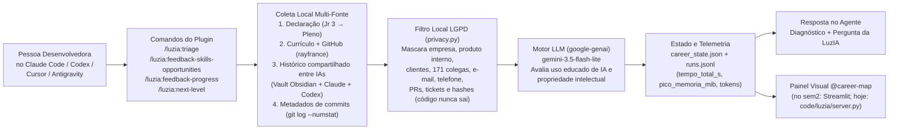

# flx · Rayane Thaís Gomes de Lima France

> fluxo e estimativa de custo do plugin **LuzIA** usado no [sem2](sem2.md).
> **A estimativa abaixo foi registrada em 11/11/2026, às 17h20, antes das execuções medidas.** As medições reais estão no [exp.md](exp.md).
> Esta folha registra a arquitetura e a estimativa de custo necessárias ao sem2.

## 1 · Arquitetura e fluxo do plugin

**Peças da implementação:**
- **Plugin multi-agente:** manifestos `.claude-plugin/plugin.json` (e equivalentes para Cursor, Codex e Antigravity), comandos slash em `.claude/commands/luzia/` e skill `luzia-mentor/SKILL.md`.
- **Motor Python (`code/luzia/`):** Python 3.14.3 · `google-genai` (`gemini-3.5-flash-lite`) · `pypdf` · `psutil` (instrumentação de memória RSS/Peak Working Set) · `streamlit` + `altair` (visualizador `@career-map`).
- **Por que API remota e não Ollama local nesta máquina:** o cliente Ollama 0.40.2 instalado falhou ao iniciar na máquina com GPU integrada Intel UHD (`Failed to start: Unable to init instance: Unspecified error`).

## 2 · Estimativa de custo (antes de medir)

| Parcela | Estimativa prévia | Origem da estimativa |
|:--|:--|:--|
| Extração e anonimização local (git + vault + currículo) | ~1,5 s | Ensaio local sem LLM no repositório de trabalho (~51 mil commits): listagem de 171 autores (~0,6 s) + 40 commits da autora (~0,7 s) + leitura de notas locais |
| Consulta à API pública do GitHub (`rayfrance`) | ~1,0 s | 2 chamadas HTTP (`users/rayfrance` e `repos`), ~0,5 s por chamada |
| Tokens de entrada | ~5.000 tokens | Prompt de sistema (~350) + triagem (~200) + currículo (~600) + GitHub (~250) + histórico compartilhado de IAs (~2.200) + 40 commits (~1.400) |
| Tokens de saída | ~1.500 tokens | JSON estruturado com diagnóstico de fontes, 6 skills, 5 tarefas recentes, 3 oportunidades e 3 marcos do plano |
| Latência do modelo (`gemini-3.5-flash-lite`) | ~10,0 s | Ping inicial de 1,39 s + geração de ~1.500 tokens estimada a ~150–200 tokens/s |
| **Tempo total estimado por execução** | **~13,0 s** | Soma das etapas locais + rede + inferência na API |
| **Pico de memória estimado no processo** | **~300 MiB** | Estimativa para o processo Python carregando SDK `google-genai`, `psutil` e bibliotecas de dados (no painel Streamlit, ~180–250 MiB; no CLI puro do plugin, menor por não carregar servidor web) |

## 3 · Hipótese de falha arquitetural (para verificação no `exp.md`)

1. **Currículo de vitrine vs. realidade do estudo:** currículos são escritos para passar em filtros de recrutamento (ex.: listar DDD e Clean Architecture para concorrer a vaga Pleno), enquanto os commits mostram código entregue com ajuda de agentes. Sem cruzar com o **histórico compartilhado de estudo e dúvidas reais** (ex.: nota `ddd-cap-01.md` no Obsidian mostrando que a autora está no Capítulo 1 aprendendo a diferença entre domínio e subdomínio), o modelo deve superestimar o nível atual de DDD/Arquitetura.
2. **Commit entregue com IA ≠ propriedade intelectual:** metadados de commit (`+384/-15` linhas em 12 arquivos C#/.NET) mostram que a funcionalidade subiu, mas não se a pessoa desenvolvedora sabe explicar as decisões tomadas pelo agente.
